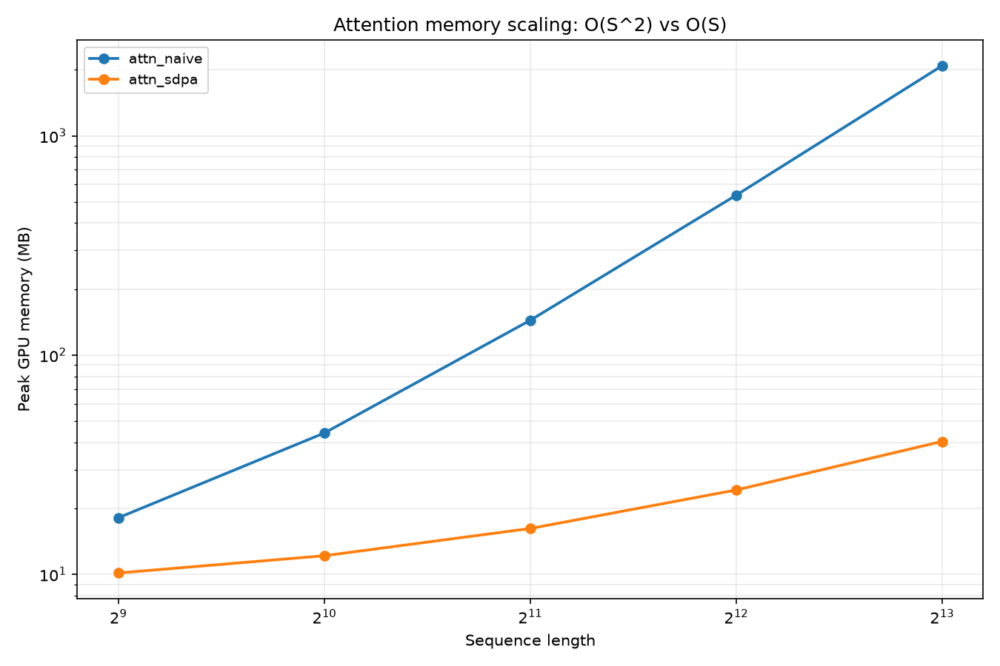
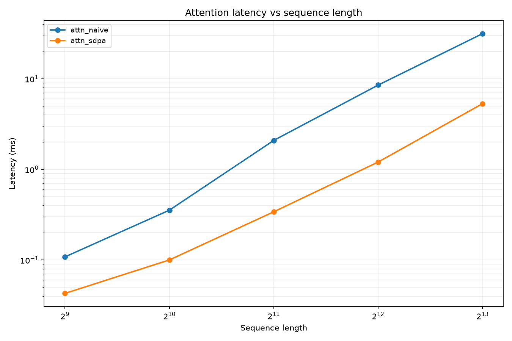

# 带宽受限 GPU 上的 Transformer 算子性能工程

> 在一张 **8 GB 显存、272 GB/s 带宽的笔记本 GPU** 上，手写 CUDA 算子、建立可复现的测量基线、
> 用 Roofline 判定瓶颈类型、用 Nsight Compute 定位访存问题。


---

## 这个项目在做什么

大多数算子优化教程告诉你"怎么把 kernel 写快"。这个项目先回答一个更前面的问题：
**你的 kernel 到底慢在哪，以及你怎么知道自己测得对？**

四件事：

1. **建立可信的测量方法** —— CUDA event 计时、L2 冲刷、用**实测持续频率**而非厂商标称值重算峰值算力
2. **用 Roofline 判定瓶颈类型** —— 先知道是 memory-bound 还是 compute-bound，再决定优化方向
3. **手写算子并逐个定位瓶颈** —— Reduce / Softmax / GELU / RMSNorm+残差融合 / Attention naive，每个都用 ncu 给出判定
4. **量化优化空间** —— 融合把 HBM 流量从 5N 降到 3N、attention 的扇区利用率只有 6.25%，这些是"改架构才能解决"的问题

> **为什么值得写**：在这张卡上做完基线之后发现，
> **一个平凡的逐元素 kernel 就能打满 81% 带宽**——所以"调参把逐元素算子写快 10%"
> 是没有意义的，真正的空间在**减少 HBM 往返**（算子融合）和**改变瓶颈类型**（FlashAttention）。

---

## 已完成的算子（全部自己从零写，含逐轮性能数据）

编译 → 正确性校验 → 计时 → 出报告，一条命令：

```bash
python kernels/bench_kernels.py            # 跑全部
python kernels/bench_kernels.py --only gelu --verbose-build
```

| 算子 | 文件 | 我的实现 | PyTorch | 有效带宽 | ncu 判定 |
|---|---|---|---|---|---|
| Reduce | `kernels/w2_reduce.cu` | 0.1137 ms | — | 147.6 GB/s（54.3%） | **DRAM 87.3%** → 已贴墙 |
| Softmax | `kernels/w2_softmax.cu` | 0.2160 ms | 0.20 ms | 155.4 GB/s（57.1%） | **SM 88.0% / DRAM 38.2%** → SM-bound（屏障） |
| GELU | `kernels/w2_gelu.cu` | **0.1516 ms** | 0.1546 ms | **221.4 GB/s（81.4%）** | memory-bound，已追平 PyTorch |
| RMSNorm+残差（融合） | `kernels/w3_fused_rmsnorm_residual.cu` | **0.2826 ms** | — | 178.1 GB/s（65.5%，bench） | **DRAM 92.8%**（199.9 µs）→ 到顶 |
| RMSNorm+残差（两 kernel） | 同上，`two_step_*` | 0.3756 ms | — | 268.0 GB/s（98.5%，6N 口径） | DRAM 91.4% / 65.1% |
| Attention naive（3 kernel） | `kernels/w4_attn_naive.cu` | **15.53 ms**（首版 46.87） | 4.41 ms | 18.4 GB/s（6.8%） | 卡在 L1 扇区 + 指令发射，未到 DRAM（残余瓶颈需 tiling） |
| FlashAttention（Triton） | `kernels/w5_flash_attn.py` | **0.474 ms** | 0.432 ms（SDPA） | 不适用，见下 | **18.1 TFLOPS（27.8% fp16 峰值）** → 比 naive 快 **32.8×**，达 SDPA 的 **91%** |
| GEMM（四级台阶） | `kernels/w6_gemm.cu` | **0.2836 ms**（naive 2.42 → tiled 1.78 → 寄存器分块 0.66 → Tensor Core 0.28） | 0.3256 ms（fp32 matmul） | 不适用（compute-bound） | **7.57 TFLOPS（fp16 峰值 11.6%）→ 1.13× PyTorch fp32 matmul**；4b 放大到 64×64 tile 反而退到 0.383 ms |
| PagedAttention decode | `kernels/w8_paged_attn_int8.cu` | **1.0419 ms**（naive 2.36 → 单遍 1.89 → 2 路 1.51 → split-L 1.25 → **K 量化 1.04**） | 8.362 ms（显式循环 ref） | 194.4 GB/s（71.5% 标称 / **87.8% 实测量**） | memory-bound；INT8 只量化 K 才划算，V 也量化反而掉回 1.20 ms |

> **口径说明**：`有效带宽 = 算法流量 ÷ 时间`，分母用 272 GB/s（标称）。
> 实测天花板是 **221 GB/s**（平凡 `scale` kernel 打出来的数）。
> **两把尺子会不一致**：融合版 bench 报 65.5%，ncu 报 92.8%（同一份代码）。
> 差 40% 的原因尚未定论，已排除降频（`clocks.mem` 恒 8200 MHz、SM 2655 MHz、77 W、60 °C）、
> CPU 入队（10 µs/次）、分配器开销（`empty_like` 0.2 µs）。**看相对加速比用 bench，看瓶颈用 ncu。**

> **FlashAttention 的带宽口径不一样**：它不把 S² 矩阵写出显存，所以「4SD + 4S²」的算法流量公式不适用。
> 套上去会算出 578 GB/s（212% 峰值）——**这本身就是公式用错的判据**。
> 真实账：DRAM 只走 Q/K/V/O 共 `4·S·D` 字节 = 16 MiB → **35.4 GB/s（13.0%）**，
> 因此这块 kernel 是 **compute-bound**：8.59 GFLOP ÷ 0.474 ms = **18.1 TFLOPS（27.8% 峰值）**。
> 反向验证：若 K/V 的 16 次重读全部打到 DRAM，需要 `34·S·D` = 142 MiB → 300 GB/s，
> 超过本机实测天花板 221 GB/s —— 物理上不可能，说明 8 MiB 的 K/V 常驻 L2。

### 五个能讲的故事

**① 一个"超过物理极限"的数字：为什么必须冲刷 L2**

同一份代码，只改 `flush_l2` 开关：

| 算子 | 冲刷 L2 | 不冲刷 | 算出的"带宽"虚高 |
|---|---|---|---|
| gelu | 224 GB/s | **512 GB/s** | **2.28×** |
| layer_norm | 217 GB/s | **426 GB/s** | 1.96× |
| residual_add | 218 GB/s | 241 GB/s | 1.11× |

**gelu 不冲刷时算出 512 GB/s —— 是本卡峰值 272 GB/s 的 1.88 倍。**
不可能超过峰值。出现这种数字只有一个解释：**测的是 L2 命中，不是 HBM 带宽。**

**② 融合：把 HBM 流量从 5N 砍到 3N**

RMSNorm + 残差，两种写法在同一个 harness 下对比：

```
fused（1 个 kernel）   0.2826 ms   3N = 48 MiB   →  ncu 199.9 µs, DRAM 92.8%
two_step（2 个 kernel）0.3756 ms   6N = 96 MiB   →  ncu 390.0 µs
                                                     实测 1.95×（理论 2.0×）
```

融合的关键不是"少一次 launch"，是**中间张量 `h` 从不落 HBM**：两 kernel 版本必须把
`h`（16 MB）写出去再读回来，融合版把它留在寄存器和共享内存里。

**③ Attention naive 慢 45 倍，卡在一个 6.25%**

```
首版 46.87 ms  vs  torch SDPA 4.41 ms     理论下限 1.05 ms（272 MiB ÷ 272 GB/s）
profiler 拆解（首版）：QKᵀ 34.3 ms / PV 10.5 ms / softmax 0.6 ms
```

QKᵀ kernel 里，warp 内相邻线程读 `K + j*D + d`，**地址间隔 D×2 = 128 B**——
每个 lane 命中一条不同的 128 B cache line，但只用到 2 B：

```
一条 128 B line → 硬件按 4 个 32 B sector 取 → 每个 lane 搬 32 B，只用 2 B
有效字节 64 B ÷ 搬运 1024 B = 6.25%      （下限 1.05 ms，差 45 倍）
```

改法：`j` 绑 `warp_id`、`d` 绑 `lane`，一个 warp 认领一行，load 覆盖 128 B 连续地址，
再用 5 轮 `__shfl_down_sync` 归约。**瓶颈从"L1 扇区吞吐"转移到"指令发射"。**

**⑤ split-L：并行度不够时，加 ILP 是白费**

PagedAttention decode 是纯带宽题（AI = 32 FLOPs/Byte，拐点 240），但先做完 ILP 优化仍然只到 87%：

```
2 路展开（每迭代 4 个独立 load）  1.5084 ms   178.1 GB/s   65.5% 标称
split-L（L 切 4 段 + merge）      1.2483 ms   216.0 GB/s   97.6% 实测量
```

原因不在 kernel 内，在**外面**：`B·H = 256` 个 warp = 32 个 block，而卡有 24 个 SM ——
`32/24 = 1.33 block/SM`，每 SM 只有 10.7 个 warp（上限 64）。**没有足够的 warp 可切换，ILP 再高也藏不住 400 周期的 load 延迟。**

split-L 把每段 L 交给一个独立 warp，grid 从 32 涨到 128（5.33 block/SM），代价只是 1 MiB 的 partial buffer（0.4%）。
**这就是 vLLM flash-decoding 的思路**，语义关键：段内结果必须保持未归一化，merge 时用 `exp(m_i - M)` 统一校正。

### 三轮优化：46.87 ms → 15.53 ms（3.02×）

| 版本 | QKᵀ | PV | softmax | 合计 | 做了什么 |
|---|---|---|---|---|---|
| v1 逐线程算 j | 34.31 | 10.55 | 0.61 | 45.46 | 一个线程算一整行点积（分工本身就错） |
| v2 warp-per-j | 14.79 | 11.10 | 0.62 | 26.51 | `j` 绑 `warp_id`、`d` 绑 `lane`；扇区利用率 6.25% → 100% |
| v3 PV 四路切 j | 16.02 | **5.37** | 0.81 | 22.20 | 输出只有 64 维 → 只有 64/256 线程有活；按 j 切 4 段 + 共享内存归约 |
| **v4 QK 加 ILP-4** | **≈9.4** | 5.37 | 0.81 | **15.53** | 4 个独立累加器交错，掩盖 5 轮 shuffle 的串行延迟 |

> 时间单位 ms，来自 `torch.profiler` 的 `Self CUDA` 折算（v1 为总量 46.87 ms 时的拆解，
> v4 的 QK 由 `15.53 − 5.37 − 0.81` 反推）。合计与 bench 的 `[PASS] 15.5290 ms` 一致。

**为什么停在这里**：剩下的瓶颈是 PV —— 每一行都要把整个 `V`（1024×64）读一遍，
按行切分无法复用。唯一出路是把 Q/K/V 分块送进共享内存、块内做 online softmax，
也就是 FlashAttention。这一步不在 naive 版本里硬凑，留给 `w5_flash_attn.py`（Triton）。


**④ Softmax 的屏障成本：20 次 → 4 次**

| 版本 | 屏障数 | 延迟 | 带宽 |
|---|---|---|---|
| 手写初版（共享内存树形归约） | 20 | 0.2478 ms | 49.8% |
| 两级归约（warp 内 shuffle） | 10 | 0.2212 ms | 55.8% |
| warp shuffle + 合并屏障 | **4** | **0.2160 ms** | **57.1%** |

每去掉一次屏障省 0.87–2.66 µs。ncu 显示 `sm__throughput 88%` 而 `dram 38%`，
**说明它已经不是内存瓶颈，而是同步开销**——继续调访存没有意义。

---

### GEMM 四级台阶：2.42 ms → 1.78 ms → 0.657 ms → 0.284 ms

M=N=K=1024、fp16；参考实现是 PyTorch 的 **fp32** matmul（0.3256 ms / 6.59 TFLOPS）。

| 台阶 | 做法 | 时间 | 算力 | 对基线 | 解决了什么 |
|---|---|---|---|---|---|
| 1 naive | 每线程算 1 个 C 元素，直读全局内存 | 2.4207 ms | 0.89 TFLOPS | 0.11× | — |
| 2 shared tiling | 32×32 tile 搬进共享内存，block 内复用 32 次 | 1.7840 ms | 1.20 TFLOPS | 0.15× | 全局内存流量降到 1/32 |
| 3 寄存器分块 | block 8×8=64 线程，每线程算 4×4 个 C 元素 | 0.6574 ms | 3.27 TFLOPS | 0.49× | 共享内存读取摊薄 4 倍（每读服务 4 次 FMA） |
| 4 Tensor Core | `wmma` 16×16×16，block 32×4=128 线程，C tile 32×32，fp32 累加后转 fp16 | **0.2836 ms** | **7.57 TFLOPS** | **1.13×** | 一次 mma 顶 4096 次 FMA，同时消掉 half2float 与 bank conflict |
| 4b Tensor Core（反例） | 同上，C tile 放大到 64×64，block 32×16=512 线程 | 0.3830 ms | 5.61 TFLOPS | 0.84× | **负结果**，原因见下 |

台阶 1–3 之间是 3.68× 的差距，每一步都能用流量账解释：naive 每算一个 C 元素要读 2·K 个元素
（2.147 G 次读取 ≈ 4.29 GB），tiling 把它压到 1/32；寄存器分块则摊薄共享内存读取——tiled 每算一个 C 元素要
`2×K = 2048` 次共享内存读，寄存器分块每 16 个元素共用 `8×K = 8192` 次，即 512 次/元素（**4×**）。

**台阶 4 把台阶 3 的三个卡点一次解决**：`wmma::mma_sync` 一条指令完成 16×16×16 的乘加（等价 4096 次 FMA），
直接吃 fp16 操作数（不再需要 8 次 `__half2float`），由硬件按 mma 布局取数（不再有 `As[ty*4+i][kk]` 的 4-way bank conflict），
也不占 CUDA core 的发射槽。0.2836 ms 对应 fp16 峰值的 11.6%，是 PyTorch fp32 matmul 的 **1.13×**。

**台阶 4b 为什么反而慢 35%**：tile 从 32×32 放大到 64×64 确实提升了复用（算术强度 16→32），
但共享内存从 4 KB 涨到 **24 KB**（`As[64][32]` + `Bs[32][64]` + `Cf[64][64]` 的 fp32 中转区），
于是每 SM 能驻留的 block 数从 **12 掉到 3**（1536 线程/SM ÷ 512 线程/block，且 24 KB×4 已超共享内存容量）。
每 SM 的 warp 总数没变（都是 48），但**并发 block 少了 4 倍**：一个 block 撞 `__syncthreads` 时，没有足够的其他 block 来填计算空档，
而这一版循环每阶段只有 2 次 `mma_sync` 却要付 2 次屏障。
结论不是"tile 越大越好"，而是 **tile 大小必须和每 SM 的驻留能力一起算**；真正的大 tile（128×128）要配 8 warp 和双缓冲流水（`cp.async`），
那是 cuBLAS 量级的工程，已超出本项目范围。

### PagedAttention decode：2.36 ms → 1.04 ms（2.26×，INT8 只量化 K 才划算）

decode 每步只有 1 个 query token，却要读完 2048 个历史 token 的 KV cache（**256 MiB**）。
KV 按 16 token 一块散落在 1024 个物理块里，靠 `block_table` 映射——这是纯带宽题：

```
流量 256 MiB，算力 8.59 GFLOP → AI = 32 FLOPs/Byte ≪ 拐点 239.7  →  memory-bound
实测天花板 221.4 GB/s  →  理论下限 1.21 ms
```

| 台阶 | 做法 | 流量 | 时间 | 带宽 | 占实测量 |
|---|---|---|---|---|---|
| 1 naive | 两遍扫描：先求 max/分母，再算加权和 | 384 MiB | 2.3644 ms | 170.3 GB/s | 76.9% |
| 2 online softmax | `m/denom/acc` 增量更新，KV 只读一遍 | 256 MiB | 1.8897 ms | 142.1 GB/s | 64.2% |
| 3 单链 2 路展开 | 一次吃 2 个 token，4 个独立 load 交错 | 256 MiB | 1.5084 ms | 178.1 GB/s | 80.4% |
| 4 split-L | L 切 4 段并行 + merge kernel | 257 MiB | 1.2483 ms | 216.0 GB/s | **97.6%** |
| 5 **K 换 int8** | 只把 KV cache 里的 K 换成 int8（V/Q/out 仍 fp16），scale 提到点积累加之后 | 193 MiB | **1.0419 ms** | **194.4 GB/s** | **87.8%** |

三步各自解决不同瓶颈，数据可以互相印证：

- **两遍 → 单遍**：省掉 K 的第二遍 128 MiB（384 → 256 MiB），1.25×。
- **单遍 → 2 路展开**：单遍时每迭代只有 2 个 load 在飞，延迟藏不住；展开到 4 个后 1.25×。
- **→ split-L**：ILP 已到寄存器上限，但 warp 总数只有 32 个 block，SM 吃不饱；切段后 grid = 128，1.21×。

**fp16 路线的终点**：`216.0 ÷ 221.4 = 97.6%`，只剩 2.4%。bench 报 79.1% 是拿 272 标称做分母，而这张卡从未到过 272。

**再快只能少搬字节**，于是做了 INT8：K 换成 int8（`scale = max|x|/127`，每 (token, head) 一个 fp16 scale）。

- **只量化 K：赢了**。流量 256 → 193 MiB，`1.0419 ms / 194.4 GB/s`，误差 `max_abs ≈ 1e-3`（容差 1e-2）。
- **K 和 V 都量化：反例**。流量再降到 130 MiB，但时间涨到 `1.2032 ms`——两条流都变成每 lane 1 字节，
  warp 每条访存指令只带 32 B，同时在飞的字节数掉一半，利用率从 87.8% 掉到 51.2%。
- **再加 vec4 加载：更差**（`1.5503 ms`，39.7%）；**再加 split-L：只回收 7%**（`1.1223 ms`，54.8%）。

> 结论：**量化省字节，向量化保每指令字节数，两者必须配套**。单向窄流（只 K）能吃到量化的红利；
> 双向窄流要靠 int8×4 打包才可能回本，而那条路需要重写索引（`d = 4·lane + k`）与归约，本项目没做。
> 八版本全表（1 个正例 + 3 个反例）见 `docs/02-实验/12-PagedAttention.md`。

**正确性**：参考实现是 PyTorch 显式循环（fp32 累加），不是 SDPA——decode 没有对应算子，
用 SDPA 会掩盖 `block_table` 映射错误。已验证 `L=2048`（主循环）与 `L=2049`（收尾块）；
**`L < BS` 尚未验证**，这是欠账。

实验全记录见 `docs/02-实验/12-PagedAttention.md`。

## 硬件平台（全部为实测值）

| 项 | 数值 | 备注 |
|---|---|---|
| GPU | NVIDIA RTX 4060 **Laptop** GPU（Ada，SM 8.9） | 24 SM / 3072 核 / 8 GB |
| 显存带宽 | 标称 **272 GB/s**，实测天花板 **221 GB/s** | 4090 是 1008 GB/s |
| **实测持续 SM 时钟** | **2655 MHz** | 厂商标称 2370；`nvidia-smi` 报的 3105 是硬件上限 |
| FP16 峰值（按实测频率重算） | **65.2 TFLOPS** | |
| **Roofline 拐点** | **240 FLOPs/Byte** | 65.2e12 ÷ 272e9 |
| 功耗 / 温度 | 峰值 89 W / 66 °C | 未撞功耗墙与温度墙 |
| 软件 | torch 2.11.0+cu128 / triton 3.6.0 / CUDA 12.8 / ncu 2025.1.1 | WSL2 Ubuntu 22.04 |

**拐点 240 FLOPs/Byte 意味着**：LayerNorm / Softmax / 标准 Attention 的算术强度只有个位数到几十，
**绝大多数算子在这张卡上都是 memory-bound**。优化的方向从一开始就确定了。

---

## PyTorch 基线（bs=1, seq=2048, hidden=4096, fp16；冲刷 L2；200 次取中位数）

| 算子 | 中位延迟 (ms) | 有效带宽 (GB/s) | 带宽利用率 | Roofline 判定 |
|---|---|---|---|---|
| gelu | 0.1495 | 224.4 | **82.5%** | memory-bound |
| layer_norm | 0.1546 | 217.1 | 79.8% | memory-bound |
| residual_add | 0.2314 | 217.5 | 80.0% | memory-bound |
| softmax | 0.1966 | 170.7 | 62.8% | memory-bound |
| rms_norm（PyTorch 分步实现） | 1.378 | 24.4 | 9.0% † | memory-bound |
| matmul 4096³ | 4.723 | 21.3 | — | compute-bound（29.1 TFLOPS = 44.6%） |
| attention（标准实现） | 1.818 | 152.3 | 56.0% | memory-bound |
| attention（torch SDPA） | 0.339 | 24.8 | — | compute-bound |

> † **这个 9.0% 是测量陷阱，不是 kernel 慢。** `bytes_layer_norm` 假设的是最小访存
> （读一遍写一遍），而 PyTorch 的分步实现会物化多个 fp32 中间张量，真实访存是它的十倍量级。
> **不要拿一个被低估的分母去下结论。**

---

## Attention 序列长度扫描：定位真正的优化空间

| 序列长度 | 标准实现显存 | 标准实现延迟 | torch SDPA 显存 | SDPA 延迟 | 显存倍数 | 延迟倍数 |
|---|---|---|---|---|---|---|
| 2048 | 144 MB | 2.09 ms | 16 MB | 0.34 ms | 9× | 6.1× |
| 4096 | 536 MB | 8.30 ms | 24 MB | 1.21 ms | 22× | 6.9× |
| 8192 | 2088 MB | 31.4 ms | 40 MB | 5.37 ms | 52× | 5.9× |
| 12288 | 4664 MB | 112.5 ms | 57 MB | 12.2 ms | 83× | 9.2× |
| **16384** | **8264 MB**（占满 8 GB 的 96%） | **2405 ms** | **73 MB** | **21.4 ms** | **113×** | **112×** |




**这是一个"崩坏"的故事，不是一个"跑不了"的故事**——而且崩坏更好讲：
S=16384 时标准实现吃掉 96% 的显存，**勉强没 OOM**，但延迟暴涨到 2.4 秒，
带宽利用率从 50% **崩到 2.6%**（显存颠簸）。

---

## 三个容易搞错的地方

| # | 坑 | 后果 | 解决 |
|---|---|---|---|
| 1 | CUDA 是**异步**的 | 用 `time.time()` 测到的是"CPU 发命令的时间" | 用 CUDA event，只在每轮末尾同步 |
| 2 | 反复测同一份数据会**命中 L2** | 测到 L2 速度，不是 HBM 带宽 | 每次计时前冲刷 L2（计时区间之外） |
| 3 | 用厂商标称频率算**峰值算力** | 所有"利用率"系统性偏移 | 实测持续 SM 时钟，再重算峰值 |

> 第 3 条的具体例子：本卡标称 boost 2370 MHz、`nvidia-smi` 报 Max Clocks 3105 MHz、
> 实测持续 **2655 MHz**。三者算出的峰值分别是 58.2 / 76.3 / **65.2** TFLOPS，
> 同一个 29.1 TFLOPS 的 matmul，"利用率"会在 **38% ~ 50%** 之间乱跳。

写 kernel 过程中踩的坑（编译错误、静默错误、性能反直觉）逐条记在
[`docs/03-错题/01-CUDA错题本.md`](docs/03-错题/01-CUDA错题本.md)（约 2300 行、71 条，按主题分组 + 编号索引），
ncu 用法与"怎么判瓶颈"记在 [`docs/01-概念/03-ncu速查.md`](docs/01-概念/03-ncu速查.md)。

---

## 目录结构

```
├── check_env.py               环境自检（13 项，每项给出修复命令）
├── gpu_watch.py               跑 benchmark 时采样时钟/功耗/温度，检测热降频
├── run_baseline.py            算子基线测量
├── run_attention_scaling.py   attention 序列长度扫描（含 OOM 处理）
├── gpulab/                    测量工具库
│   ├── specs.py                 显卡规格 + Roofline + 实测频率重算
│   ├── timer.py                 CUDA event 计时（warmup + L2 冲刷 + 分位数）
│   ├── workloads.py             FLOPs / 访存字节数公式
│   ├── verify.py                与 PyTorch 参考实现的正确性校验
│   ├── plotting.py              Roofline 图 / 伸缩曲线
│   └── report.py                markdown 报告生成
├── kernels/
│   ├── bench_kernels.py         编译 → 验证 → 测量 → 出报告（一条命令跑全部）
│   ├── w2_reduce.cu             warp shuffle 两级归约
│   ├── w2_softmax.cu            合并屏障版 softmax（20 → 4 次屏障）
│   ├── w2_gelu.cu               __half2 向量化（81.4% 带宽）
│   ├── w3_fused_rmsnorm_residual.cu  融合版 + 两 kernel 对照
│   ├── w4_attn_naive.cu         naive attention（QKᵀ / softmax / PV 三个 kernel）
│   ├── w5_flash_attn.py         FlashAttention（Triton，online softmax；D≤64、无 causal）
│   ├── w6_gemm.cu               GEMM 四级台阶（naive / tiling / 4×4 寄存器分块 / wmma Tensor Core）
│   ├── w7_paged_attn_split.cu   PagedAttention decode split-L（1.2483 ms，97.6% 实测带宽）
│   ├── w7_paged_attn.cu         单链 2 路展开版（1.5084 ms）
│   ├── w8_paged_attn_int8.cu    INT8 只量化 K（1.0419 ms，本项目最优）
│   ├── w8_paged_attn_int8kv.cu  INT8 量化 K+V（反例，1.2032 ms）
│   ├── w8_paged_attn_int8kv_vec4.cu  再加 vec4 加载（反例，1.5503 ms）
│   ├── w8_paged_attn_int8kvsplit.cu  再加 split-L（反例，1.1223 ms）
│   ├── README.md               课程顺序、验收标准、五问
│   └── 骨架默写卡.md            12 个可默写的 kernel 骨架（6 天轮换）
├── docs/                       概念、实验记录、错题本、复习材料
│   ├── 00-索引.md                全部文档的地图
│   ├── 01-概念/                 如何写 kernel / CUDA 速查 / ncu 速查 / attention 入门 / FlashAttention / 流与图
│   ├── 02-实验/                 GEMM 台阶 4 分析 / PagedAttention 八版记录 / launch 与并发
│   ├── 03-错题/                 CUDA 错题本（77 条）/ cuda-guide 自测清单
│   └── 04-复习/                 项目总账（数字口径 + 面试清单）
└── results/                   全部实测数据（只有一个 results/，不分散）
    ├── kernels.md             最近一次 bench 的逐算子结果（每次跑覆盖）
    ├── paged_attn_versions.md  PagedAttention 八个版本的固定记录（手写维护）
    ├── baseline.md            Roofline 基线与理论峰值
    ├── attention_scaling.md   序列长度→时延/显存的缩放实验
    ├── fig_*.png              Roofline / attention 图
    └── ncu/                   Nsight Compute 剖面摘录（reduce / softmax / fused）
```

---

## 快速开始

```bash
conda activate triton                          # torch 2.11.0+cu128 / triton 3.6.0
cd aigpu-lab

python check_env.py                            # 环境自检（13 项）
python gpu_watch.py -- python run_baseline.py  # 基线 + 热降频监测
python run_attention_scaling.py                # attention 扫描 + 出图
python kernels/bench_kernels.py                # 自写 kernel：编译/校验/计时/出报告
python kernels/bench_kernels.py --only fused   # 只跑名字含 fused 的
```

产出全部写入 `results/`。

### 用 ncu 复盘任意一个 kernel

```bash
export PATH=/usr/local/cuda-12.8/bin:$PATH       # ncu 不在默认 PATH
ncu --clock-control none --set full -c 1 \
    --kernel-name regex:gelu \
    python kernels/bench_kernels.py --only gelu --iters 1
```

已有的剖面数据摘录在 [`results/ncu/`](results/ncu/)。

---

## 已知限制

- **单卡，没有多卡 / 分布式经验。** 训练侧（Deepspeed / Megatron / 张量并行）没有实机验证过。
- **笔记本 GPU 的持续频率受功耗墙与散热影响**，绝对延迟不具备跨机器可比性；
  可比的是**加速比**与**带宽利用率**。
- **Attention 有 naive 与 FlashAttention 两版**：naive 三 kernel 从 46.87 ms 优化到 15.53 ms（warp-per-j + PV 四路切分 + QK 的 ILP-4）；
  FlashAttention（Triton，online softmax）**0.474 ms = naive 的 1/32.8，达 PyTorch SDPA 的 91%**。
- **FlashAttention 的调参结论**（24 组扫描）：`Block_m=64 / Block_n=128 / num_warps=4 / num_stages=2`
  从 0.580 ms 降到 0.474 ms；`num_warps=8` 会掉到 0.87 ms（每 warp 只剩 8 行，喂不饱 Tensor Core 的最小 mma 粒度）。
- **FlashAttention 只支持 `head_dim ≤ 64`、无 causal mask**；再往上的收益需要 `p` 保持 fp32 的指令级优化与 split-K 并行。
- **naive attention 的带宽利用率只有 6.8%**，不是测错：S² 矩阵要落显存四次往返，瓶颈在指令发射与 L1 扇区而非 HBM。它存在的意义是当 FlashAttention 的分母。
- **GEMM 已用上 Tensor Core**：`wmma` 版本 0.2836 ms / 7.57 TFLOPS = PyTorch fp32 matmul 的 **1.13×**；
  台阶 4b（64×64 tile）反而慢 35%，原因是 24 KB 共享内存把每 SM 驻留 block 数从 12 压到 3、屏障无法被掩盖。
  这条负结果比正结果更能说明"tile 大小要与占用率一起算"。
  **口径说明**：1.13× 的基线是 **fp32 matmul**。若基线换成 `torch.matmul`（fp16、走 Tensor Core），
  按 7.57 TFLOPS 与 TC 理论值估算，本实现约为其 **0.2–0.4×**（未实测，仅估算）——
  也就是说差距在 double buffering 与 swizzle，不在 mma 本身。
  **进行中（2026-10-31 起）**：64×64 tile + 每 warp 2×2 + swizzle → double buffering + `cp.async`，目标 ≤ 0.19 ms。
- **bench 与 ncu 两把尺子差 40%，原因未定论**（已排除降频/入队/分配器），见上方口径说明。
- **PagedAttention decode 最优是 INT8 只量化 K**（1.0419 ms，194.4 GB/s = 87.8% 实测带宽）；
  fp16 版是 1.2483 ms / 97.6%。量化把流量从 256 降到 193 MiB，但窄流也把利用率拉低了 10 个点。
  **KV 全量化的四条分支全是反例**（1.12–1.55 ms），原因与验证过程写在实验记录里。
- **PagedAttention 的 `L < BS`（不足一块）分支尚未验证**，只测过 `L=2048` 与 `L=2049`。
- **PyTorch 基线不是 SDPA**：decode 阶段没有对应的 torch 算子，参考实现是显式循环（8.36 ms），
  所以 6.70× 的加速比**不能**拿去和 SDPA 比较。
- 精度实验上限是 FP8（Ada 不支持 FP4）。

---

## 参考

- [Roofline 模型原始论文](https://dl.acm.org/doi/10.1145/1498765.1498785)
- [FlashAttention](https://arxiv.org/abs/2205.14135) / [FlashAttention-2](https://arxiv.org/abs/2307.08691)
- [CUDA C++ Programming Guide](https://docs.nvidia.com/cuda/cuda-c-programming-guide/)
- [Nsight Compute 文档](https://docs.nvidia.com/nsight-compute/)
- [Triton 官方教程](https://triton-lang.org/main/getting-started/tutorials/index.html)
