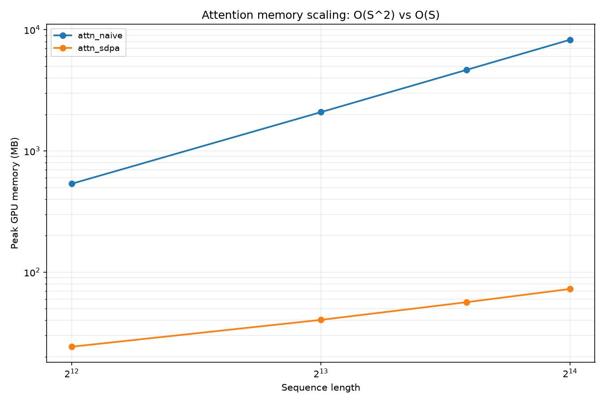
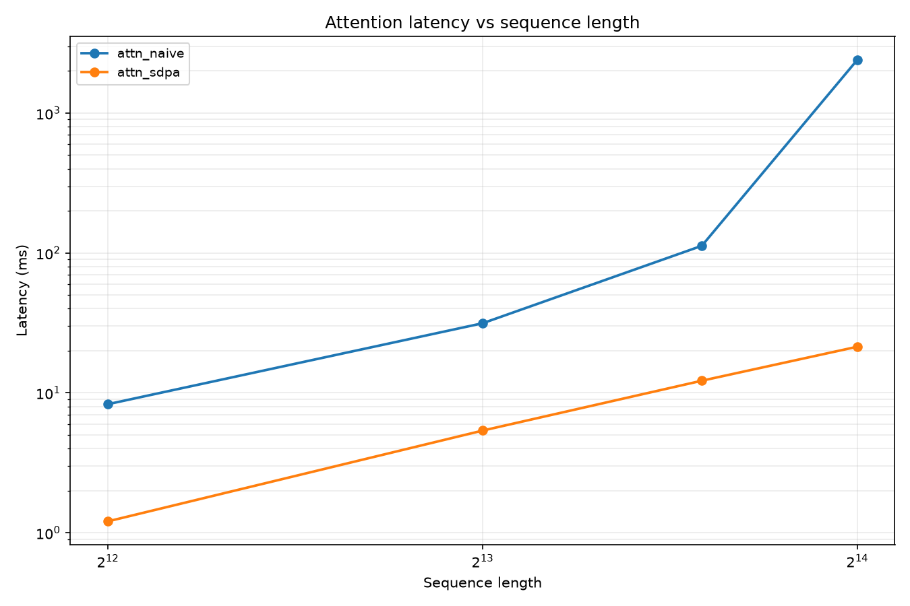

# 带宽受限 GPU 上的 Transformer 算子性能工程

> 在一张 **8GB 显存、272 GB/s 带宽的笔记本 GPU** 上，建立可复现的算子性能测量基线、
> 用 Roofline 判定瓶颈类型、并用 Nsight Compute 定位访存问题。
>
> **当前状态**：测量基础设施与基线数据已完成；CUDA/Triton 算子实现进行中。


---

## 这个项目在做什么

大多数算子优化的教程告诉你"怎么把 kernel 写快"。这个项目先回答一个更前面的问题：
**你的 kernel 到底慢在哪，以及你怎么知道自己测得对？**

三件事：

1. **建立可信的测量方法** —— CUDA event 计时、L2 冲刷、用**实测持续频率**而非厂商标称值重算峰值算力
2. **用 Roofline 判定瓶颈类型** —— 先知道是 memory-bound 还是 compute-bound，再决定优化方向
3. **量化优化空间** —— 用 attention 的序列长度扫描，定位真正值得优化的地方

> **为什么值得写**：在这张卡上做完基线之后发现，
> **一个平凡的逐元素 kernel 就能打满 81% 带宽**——所以"调参把逐元素算子写快 10%"
> 是没有意义的，真正的空间在**减少 HBM 往返**（算子融合）和**改变瓶颈类型**（FlashAttention）。

---

## 硬件平台（全部为实测值）

| 项 | 数值 | 备注 |
|---|---|---|
| GPU | NVIDIA RTX 4060 **Laptop** GPU（Ada，SM 8.9） | |
| SM / CUDA 核心 | 24 / 3072 | |
| 显存 / 带宽 | 8 GB / **272 GB/s** | 4090 是 1008 GB/s |
| **实测持续 SM 时钟** | **2655 MHz** | 厂商标称 2370；`nvidia-smi` 报的 3105 是硬件上限 |
| FP16 峰值（按实测频率重算） | **65.2 TFLOPS** | |
| **Roofline 拐点** | **240 FLOPs/Byte** | |
| 功耗 | 峰值 **89 W**（墙上限 126 W，Default 仅 55 W） | |
| 温度 | 峰值 **66 °C** | 散热够用，未撞墙 |
| 软件 | torch 2.11.0+cu128 / triton 3.6.0 / CUDA 12.8 | |

**拐点 240 FLOPs/Byte 意味着**：LayerNorm / Softmax / 标准 Attention 的算术强度只有个位数到几十，
**绝大多数算子在这张卡上都是 memory-bound**。优化的方向从一开始就确定了。

---

## 关键结果

### 1. 算子基线（bs=1, seq=2048, hidden=4096, fp16；冲刷 L2；200 次取中位数）

| 算子 | 中位延迟 (ms) | 有效带宽 (GB/s) | 带宽利用率 | Roofline 判定 |
|---|---|---|---|---|
| gelu | 0.1495 | 224.4 | **82.5%** | memory-bound |
| layer_norm | 0.1546 | 217.1 | 79.8% | memory-bound |
| residual_add | 0.2314 | 217.5 | 80.0% | memory-bound |
| softmax | 0.1966 | 170.7 | 62.8% | memory-bound |
| rms_norm（PyTorch 分步实现） | 1.378 | 24.4 | 9.0% † | memory-bound |
| matmul 4096³ | 4.723 | 21.3 | — | compute-bound（29.1 TFLOPS = 峰值的 44.6%） |
| attention（标准实现） | 1.818 | 152.3 | 56.0% | memory-bound |
| attention（torch SDPA） | 0.339 | 24.8 | — | compute-bound |

> † **这个 9.0% 是测量陷阱，不是 kernel 慢。** `bytes_layer_norm` 假设的是最小访存
> （读一遍写一遍），而 PyTorch 的分步实现会物化多个 fp32 中间张量，真实访存是它的十倍量级。
> **不要拿一个被低估的分母去下结论。** 真实结论是"这个实现有大量冗余访存"——
> 这也正是算子融合的价值所在。

### 2. 一个"超过物理极限"的数字：为什么必须冲刷 L2

同一份代码，只改 `flush_l2` 开关：

| 算子 | 冲刷 L2 | 不冲刷 | 算出的"带宽"虚高 |
|---|---|---|---|
| gelu | 224 GB/s | **512 GB/s** | **2.28×** |
| layer_norm | 217 GB/s | **426 GB/s** | 1.96× |
| residual_add | 218 GB/s | 241 GB/s | 1.11× |
| matmul 4096³ | 21.3 GB/s | 20.5 GB/s | 0.96× |

**gelu 不冲刷时算出 512 GB/s —— 是本卡峰值 272 GB/s 的 1.88 倍。**

不可能超过峰值。出现这种数字只有一个解释：**测的是 L2 命中，不是 HBM 带宽。**
（小工作集的算子受影响最大：gelu 输入+输出约 34MB，接近 L2 容量。）

> **这条能救命**：虚高的数字看起来像好事，你不会去怀疑它。

### 3. Attention 序列长度扫描：定位真正的优化空间

| 序列长度 | 标准实现显存 | 标准实现延迟 | torch SDPA 显存 | SDPA 延迟 | 显存倍数 | 延迟倍数 |
|---|---|---|---|---|---|---|
| 2048 | 144 MB | 2.09 ms | 16 MB | 0.34 ms | 9× | 6.1× |
| 4096 | 536 MB | 8.30 ms | 24 MB | 1.21 ms | 22× | 6.9× |
| 8192 | 2088 MB | 31.4 ms | 40 MB | 5.37 ms | 52× | 5.9× |
| 12288 | 4664 MB | 112.5 ms | 57 MB | 12.2 ms | 83× | 9.2× |
| **16384** | **8264 MB**（占满 8GB 的 96%） | **2405 ms** | **73 MB** | **21.4 ms** | **113×** | **112×** |



**这是一个"崩坏"的故事，不是一个"跑不了"的故事**——而且崩坏更好讲：
S=16384 时标准实现吃掉 96% 的显存，**勉强没 OOM**，但延迟暴涨到 2.4 秒，
带宽利用率从 50% **崩到 2.6%**（显存颠簸）。



### 4. Nsight Compute 剖面

对 `vectorized_layer_norm_kernel` 做剖面（`results/ncu/layer_norm.txt`）：

```
Memory Throughput      : 90.72 %     ← DRAM 带宽利用率
Memory Throughput      : 237.72 Gbyte/s
Compute (SM) Throughput: 57.17 %
Achieved Occupancy     : 93.14 %
Duration               : 119.55 us
```

**Memory 90.7% vs Compute 57.2% —— 确认是 memory-bound，与 Roofline 预测一致。**

作为对照，PyTorch 的 `rms_norm` 分步实现被拆成 **7 个 kernel launch**
（`results/ncu/rmsnorm_naive.txt`），每个都要读写一遍 HBM。

---

## 三个容易搞错的地方

| # | 坑 | 后果 | 解决 |
|---|---|---|---|
| 1 | CUDA 是**异步**的 | 用 `time.time()` 测到的是"CPU 发命令的时间" | 用 CUDA event，只在每轮末尾同步 |
| 2 | 反复测同一份数据会**命中 L2** | 测到 L2 速度，不是 HBM 带宽 | 每次计时前冲刷 L2（计时区间之外） |
| 3 | 用厂商标称频率算**峰值算力** | 所有"利用率"系统性偏移 | 实测持续 SM 时钟，再重算峰值 |

> 第 3 条的具体例子：本卡标称 boost 2370 MHz、`nvidia-smi` 报 Max Clocks 3105 MHz、
> 实测持续 **2655 MHz**。三者算出的峰值分别是 58.2 / 76.3 / **65.2** TFLOPS，
> 同一个 29.1 TFLOPS 的 matmul，"利用率"会在 **38% ~ 50%** 之间乱跳。

---

## 目录结构

```
├── check_env.py               环境自检（13 项，每项给出修复命令）
├── gpu_watch.py               跑 benchmark 时采样时钟/功耗/温度，检测热降频
├── run_baseline.py            算子基线测量
├── run_attention_scaling.py   attention 序列长度扫描（含 OOM 处理）
├── gpulab/                    测量工具库
│   ├── specs.py                 显卡规格 + Roofline + 实测频率重算
│   ├── timer.py                 CUDA event 计时（warmup + L2 冲刷 + 分位数）
│   ├── workloads.py             FLOPs / 访存字节数公式
│   ├── verify.py                与 PyTorch 参考实现的正确性校验
│   ├── plotting.py              Roofline 图 / 伸缩曲线
│   └── report.py                markdown 报告生成
├── kernels/                   CUDA / Triton 算子（进行中）
│   ├── bench_kernels.py         编译 → 验证 → 测量 → 出报告
│   └── w2_rmsnorm.cu            骨架（正在实现）
├── docs/                      开发说明、README 模板、博客草稿
└── results/                   实测报告、原始数据、图表、ncu 剖面
```

---

## 快速开始

```bash
conda activate triton          # 或你自己的环境
cd aigpu-lab

python check_env.py                              # 环境自检
python gpu_watch.py -- python run_baseline.py    # 基线 + 热降频监测
python run_attention_scaling.py                  # attention 扫描 + 出图
python kernels/bench_kernels.py --harness-test   # 验证 CUDA 编译链路
```

产出全部写入 `results/`。

---

## 已知限制

- **单卡，没有多卡 / 分布式经验。** 分布式部分我只在单机上用 gloo 后端模拟过通信原语，
  并读过 Megatron-LM 的张量并行实现，**没有实机验证过**。
- **笔记本 GPU 的持续频率受功耗墙与散热影响**，绝对延迟不具备跨机器可比性；
  可比的是**加速比**与**带宽利用率**。
- **算子实现进行中** —— 目前完成的是测量基础设施与基线，CUDA kernel 尚未实现。
- 精度实验上限是 FP8（Ada 不支持 FP4）。

---

## 参考

- [Roofline 模型原始论文](https://dl.acm.org/doi/10.1145/1498765.1498785)
- [FlashAttention](https://arxiv.org/abs/2205.14135) / [FlashAttention-2](https://arxiv.org/abs/2307.08691)
- [CUDA C++ Programming Guide](https://docs.nvidia.com/cuda/cuda-c-programming-guide/)
- [Nsight Compute 文档](https://docs.nvidia.com/nsight-compute/)
- [Triton 官方教程](https://triton-lang.org/main/getting-started/tutorials/index.html)
